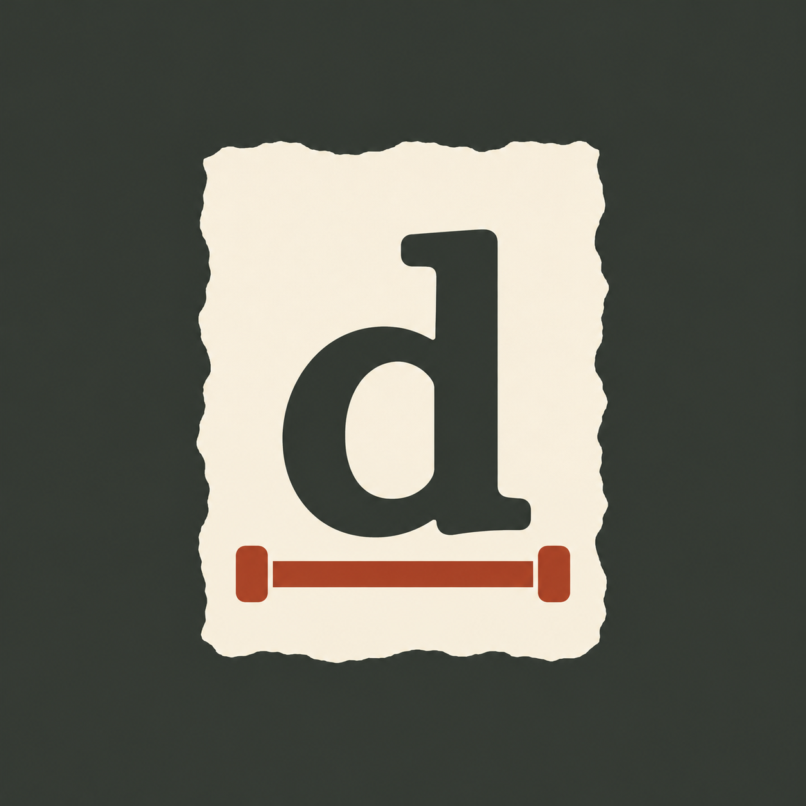

# Deckle

A place for your words. Deckle is a writing desk with a mechanical typewriter, torn paper, a filing tray, notes, adjustable lamps, and the sound of the keys.

[Open Deckle](https://deckle.farzin.space)

Start writing without an account. Your desk saves in this browser. Sign in when you want an account, then choose Cloud in Settings → Storage to synchronize the desk across devices. Cloud saving is optional.

## Writing at the desk

- Choose a machine, paper, desk surface, clock, and lighting. New desks start with Cherry and the lights on. Saved choices stay yours.
- An optional guided setup introduces the desk, lamps, Notes drawer, daily writing battery, and text selection.
- Type and edit anywhere on the paper. Draft corrections erase; Ink corrections preserve the original marks.
- Accounts enabled through [feature flags](docs/feature-flags.md) can ask Ghostwriter to check grammar or wording, or explicitly permit structure changes. Review suggestions beside the paper, then Fix one or Fix all through the machine. Local corrections retain other suggestions; unrelated wording changes clear the pass. Undo restores the last fix or group. [Ghostwriter behavior and setup](docs/ghostwriter.md).
- Tear and file finished papers, search the archive, read a paper, or replay its writing history.
- Export Markdown, printable papers, share images, or a complete archive including replay logs. Import an archive to move writing between browsers.
- Local writing saves to IndexedDB. Cloud mode keeps a browser copy and queues offline changes for the next connection. Conflicting versions are preserved for you to combine.

Clearing browser data removes local papers. Keep an exported archive for work you need to preserve. Settings → Start from scratch permanently deletes the signed-in account and its current cloud data, clears this browser's Deckle data, and signs out. See [storage and deletion details](docs/storage.md), including the limits around downloaded exports, other devices, and provider backups.

## Development

Use Node.js 24 and npm.

```sh
npm ci
cp .env.example .env.local
npm run dev
```

Fill in your own Clerk development keys in `.env.local`. Clerk is required for the authentication integration; users can still write without signing in. Use a separate Clerk application for your own deployment.

Cloud storage also needs a Convex project. Run `npx convex dev` to create or link a development deployment. Set the same randomly generated `DECKLE_BRIDGE_SECRET` in `.env.local` and Convex, and set `NEXT_PUBLIC_CONVEX_SITE_URL` to that deployment's HTTP site URL. Set `APP_URL` to your local app origin.

The optional `make dev` command uses [Portless](https://github.com/vercel-labs/portless) to serve `https://deckle.localhost`. It replaces only this checkout's existing Deckle development servers.

```sh
npm test
npm run typecheck
npm run build
```

## Deployment

The public app runs on Vercel. GitHub's `main` branch is the production branch; pushes to `main` automatically build and deploy the app. Local development, Vercel previews, and the public app currently share the development Clerk instance and Convex deployment.

For your own deployment, import the repository into Vercel and configure these variables in Development, Preview, and Production:

- `NEXT_PUBLIC_CLERK_PUBLISHABLE_KEY` and `CLERK_SECRET_KEY` from the same development Clerk instance.
- `NEXT_PUBLIC_CONVEX_URL`, the development Convex deployment's cloud URL.
- `CONVEX_SITE_URL` and `NEXT_PUBLIC_CONVEX_SITE_URL`, that development deployment's HTTP site URL.
- `DECKLE_BRIDGE_SECRET`, matching the secret configured in development Convex.

Set `APP_URL` to the canonical HTTPS origin in Vercel Production and your local origin in `.env.local`. Omit it in Preview so requests use the preview origin. The checked-in Vercel build command builds the app without deploying Convex. Use `npx convex dev --once` to sync development backend changes. No production Clerk or Convex credentials are needed for the current setup.

Google and Apple sign-in use Clerk's shared development OAuth credentials. Local writing works without signing in.

## Project map

- `components/deckle.tsx` owns desk interactions; `components/onboarding.tsx` introduces them.
- `components/paper-editor.tsx` connects CodeMirror to the writing model and physical paper.
- `lib/writing.ts` and `lib/editor-model.ts` define editing, replay, and exports.
- `lib/storage.ts` saves browser desks; `lib/cloud/` and `convex/` handle optional account storage.
- `docs/storage.md`, `docs/desk-setup.md`, and `docs/sharing-and-activity.md` describe current behavior.
- `DECKLE.md`, `PRODUCT.md`, and `DESIGN.md` record the product brief and design decisions. Some original brief items remain aspirational.

## Assets

The Deckle logo and browser/install icons are in `public/brand/`, `public/icons/`, and `app/`. [Brand asset notes](docs/brand.md) include the source prompt and export sizes. The install manifest supports standalone windows and masked app icons. Offline reload is not guaranteed; the app does not currently ship a service worker.

Audio recording sources and CC0 licenses are in [public/audio/SOURCES.md](public/audio/SOURCES.md). Font licenses are in [public/fonts/](public/fonts/). Paper and desk textures are generated by the scripts in `scripts/`.
